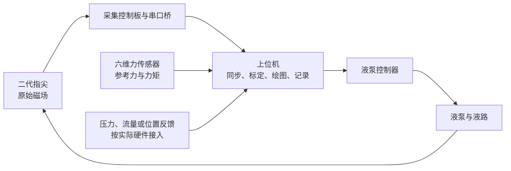
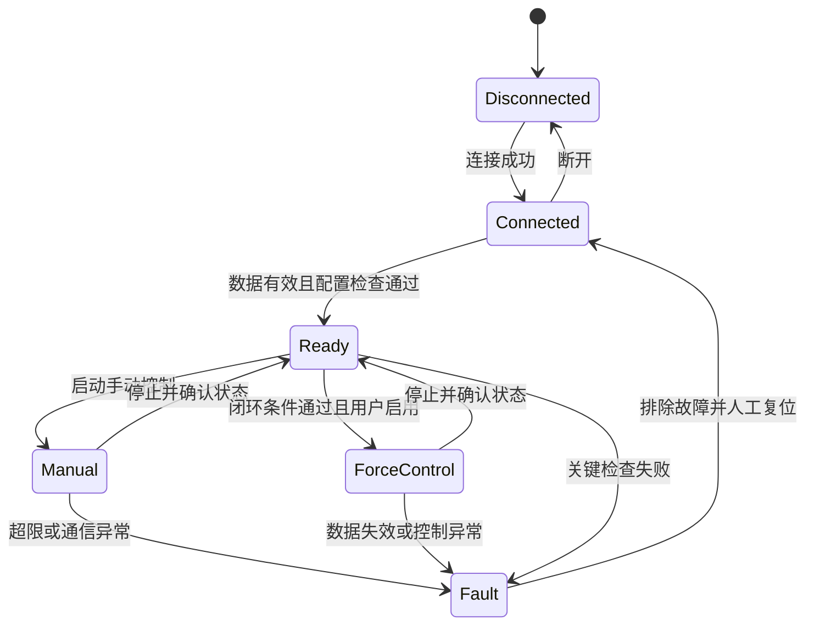

# 二代指尖接触力标定与上位机实施方案

> **目标：**用六维力传感器作为参考，将二代指尖的磁场信号转换为接触力，并开发能够实时显示力曲线、记录实验、控制液泵和查看反馈的上位机。
>
> **第一阶段范围：**4 个传感器，先完成限定接触位置和姿态下的法向接触力标定。三轴力与自动力控在相应验证完成后扩展。

| 项目 | 说明 |
|---|---|
| 文档版本 | v1.0 |
| 更新日期 | 2026-10-13 |
| 适用仓库 | `leon6699xe/SENSOR` |
| 资料基线 | 硬件说明与 6 张照片；基线提交 `a67ffe701045ef8e0bf6ad8692b9c85699371531` |
| 已确认需求 | 二代有 4 个传感器；测量接触力；显示力曲线与液泵输入、输出 |
| 尚未确认 | 二代数据格式、工作范围、参考传感器型号与协议、液泵型号与反馈能力 |
| 验证状态 | 本文是实施设计；尚未连接实物、执行标定或验证上位机 |

## 阅读导航

1. [需求与实施边界](#scope)
2. [系统结构与硬件准备](#system)
3. [接触力标定操作流程](#calibration)
4. [数据采集与记录规范](#data)
5. [标定模型与验证方法](#model)
6. [上位机页面与软件结构](#ui)
7. [液泵控制与反馈闭环](#pump)
8. [实施阶段与交付清单](#delivery)
9. [验收标准与常见问题](#acceptance)
10. [首次实验检查表](#checklist)
11. [已有硬件资料索引](#references)

<a id="scope"></a>

## 1. 需求与实施边界

### 1.1 两项交付目标

| 目标 | 最终得到什么 | 需要验证什么 |
|---|---|---|
| 二代指尖标定 | 原始实验数据、可复现的标定流程、模型文件、误差报告 | 指尖估计力与六维参考力在有效工作范围内一致 |
| 上位机开发 | 设备连接、实时曲线、数据记录与回放、液泵控制及反馈页面 | 数据正确、界面连续运行、命令与反馈可追踪、异常时行为明确 |

### 1.2 区分文档记录、实物观察与设计建议

| 信息 | 依据 | 使用方式 |
|---|---|---|
| 四颗 MLX90393、STM32C031F6P6、ESP32-S3 的采集链路 | [现有接线说明](../传感器硬件复现与接线说明.md) | 作为初代资料；二代是否相同需核对 |
| USART2 / PA2、115200、8N1；约 0.5 秒输出一次 | 接线说明记录 | 用于现有链路检查，不当作二代已验证参数 |
| `Zmag` 是滤波后 Z 轴磁场绝对值；`n` 是窗口有效读数数目 | 接线说明记录 | `Zmag` 不能直接标成 N，`n` 不能当成力 |
| 二代包含 4 个传感器、目标为接触力 | 用户确认 | 当前方案的需求基础 |
| ST-LINK、板件、线束和端部封装 | 仓库照片 | 不能仅凭线色推断引脚，也不能辨认全部芯片或通信协议 |
| 采集频率、模型、页面与验收阈值 | 本方案建议 | 通过实测和设备规格确认后采用 |

当前仓库未包含“初代指尖”目录、STM32 / ESP32 源码或已有上位机。说明中的本地固件路径不等于仓库中已有该文件。

### 1.3 测量范围分阶段确定

| 阶段 | 输出量 | 启用条件 |
|---|---|---|
| 第一阶段，必做 | 法向接触力 `Fn`，单位 N | 固定接触姿态和位置，完成独立验证 |
| 第二阶段，按需求扩展 | `Fx、Fy、Fz` | 结构响应可区分三轴载荷，具备切向加载数据 |
| 完整六维，另行评估 | `Fx、Fy、Fz、Mx、My、Mz` | 具备独立力矩加载、充分组合载荷和可辨识性验证 |

六维参考传感器提供六维测量，并不保证指尖能反演六维量。只有四路 `|Bz|` 时，先限定为准静态法向标定；如果固件和硬件允许，后续优先保留四颗传感器的带符号 `Bx、By、Bz`，但仍须验证其可辨识性。

<a id="system"></a>

## 2. 系统结构与硬件准备

### 2.1 系统结构



液泵控制器与反馈传感器是独立接口；不要默认它们已经通过指尖 STM32 或 ESP32 接入。参考传感器可以只在标定与复核时连接，正常运行使用已验证的指尖模型。

### 2.2 设备与确认事项

| 设备 / 资料 | 用途 | 实施前确认 |
|---|---|---|
| 二代指尖与控制板 | 采集磁场 | 通道编号、硬件版本、固件版本、输出单位、有效量程 |
| ESP32-S3 或兼容的 3.3 V USB-UART | 连接电脑 | 接口、接收引脚、供电方式、串口桥是否修改数据 |
| 六维力传感器及采集器 | 提供参考测量 | 型号、各轴量程、允许力矩、单位、坐标、采样率、协议、校准状态 |
| 位移台 / 可控加载机构 | 重复施加载荷 | 调节精度、固定方式、行程限制 |
| 标定夹具与接触压头 | 固定载荷路径 | 尺寸、材料、刚度、压头形状、接触位置 |
| 液泵、驱动器、阀及液路 | 改变液体状态 | 型号、协议、额定压力、方向、停止与卸压行为 |
| 压力 / 流量 / 位置反馈 | 显示实际输出 | 是否已有、测量范围、单位、刷新率 |
| 电脑及万用表 | 采集与接线确认 | 系统、驱动、串口识别、共地与电源检查 |

### 2.3 沿用初代链路时的连接依据

仅在确认二代沿用现有硬件后，采用下列连接；详细供电与烧录步骤见原接线说明。

| 信号 | 现有说明中的连接 |
|---|---|
| 传感器供电 | 稳定 5 V 接板上 `5V`，板内 LDO 输出 3.3 V |
| 数据输出 | STM32 `PA2 / USART2_TX` → ESP32 `GPIO4 / RX` |
| 信号参考 | 传感器与串口桥共地 |
| 电脑连接 | ESP32 USB → 电脑 |
| 调试 | ST-LINK 接 SWDIO、SWCLK、GND；供电与参考电压按原说明确认 |

**ST-LINK 用于烧录与调试，不替代数据串口桥。**不要把 5 V 串口电平接入 ESP32 GPIO，也不要把 ST-LINK 的 3.3 V / Vref 接到板上 5 V 输入。照片中的线色不能作为接线依据。

### 2.4 标定夹具

推荐固定二代指尖，使位移台带动六维传感器及压头沿指尖法向慢速移动：

```text
可控位移台 → 六维传感器 → 压头 → 二代指尖 → 固定基座
                           同一条接触力传递路径
```

夹具要求：

- 压头只接触指定区域，其他壳体、支撑件不承担接触载荷。
- 线缆和液管留有松弛，不拉扯指尖或参考传感器。
- 初始阶段固定姿态、磁铁位置、软体材料、填充液量和预压力。
- 记录压头形状、接触位置、装配尺寸和照片；重新装配后按同一记录复现。
- 先采用机械慢速加载；基础标定通过后再检查泵工作条件的影响。

<a id="calibration"></a>

## 3. 接触力标定操作流程

### 3.1 实验前定义

将以下项目写入实验元数据，未知项不要填猜测值：

| 参数 | 定义 / 确认方法 |
|---|---|
| 接触法向 | 在夹具上标出法向，第一阶段将压缩接触力定义为正 |
| 坐标系 | 指尖与参考传感器各轴方向、原点、安装旋转关系 |
| `F_work_max` | 经规格和小载荷试验确认的最大工作接触力，不直接取额定满量程 |
| 加载停止条件 | 力、力矩、变形、位移、压力或传感器饱和中任一到限即停止 |
| 初始状态 | 无接触姿态、液量、预压力、温度（如可测）、稳定等待条件 |
| 接触位置 | 第一阶段固定中心位置，记录实际尺寸与方向 |

参考传感器需同时满足各轴力和力矩限制。偏心加载可能在法向力较小时就超过力矩范围，因此不能只检查 `Fz`。

### 3.2 零点与方向检查

1. 按设备要求预热并等待无接触读数稳定。
2. 保存约 **30 秒**的指尖原始数据和参考数据，记录均值、噪声、有效读数和时间。
3. 在该安装条件下记录磁场零点 `B0` 与参考零点；保留原始数据，不覆盖原始文件。
4. 做一次小幅法向接触，检查两套信号方向和参考轴映射，将最终 `Fn` 的压缩方向统一为正。
5. 卸载并检查回零。如果明显漂移，先检查装配、液压状态、磁铁和采集问题，再开始正式实验。

无接触才允许清零。若泵改变了指尖内部形态，无接触磁场也可能变化；应记录该状态并评估是否需要条件模型，不能通过每次任意清零掩盖它。

### 3.3 第一轮实验矩阵

建议使用 **11 个目标水平、5 个完整加载循环**。目标力水平如下，实际测得的参考力才是模型标签：

```text
加载：0 → 10% → 20% → … → 100% × F_work_max
卸载：100% → 90% → … → 0% × F_work_max
```

| 实验 | 条件 | 数据用途 |
|---|---|---|
| 循环 1～3 | 同一安装、中心接触、固定液压初态 | 训练；比较循环重复性 |
| 循环 4 | 相同工作条件、独立完整循环 | 选择模型、特征和超参数 |
| 循环 5 | 相同工作条件、独立完整循环 | 最终测试；不参与调参 |
| 泵无接触试验 | 在确认的允许范围内改变泵状态，保持无外部接触 | 检查内部变形及磁场干扰，不与加载数据混淆 |
| 泵工作复核 | 选择低、中、高三个已验证力水平并加入预定泵状态 | 判断原模型能否用于真实工作条件 |
| 扩展接触位置 | 中心之外的实际使用位置 | 仅在需要跨位置测量时加入训练和独立验证 |

每一级的操作：**调节位移 → 等待参考力稳定 → 采集稳定段 → 标记实验阶段 → 进入下一水平**。不要求手动恰好达到每个目标力；记录真实力和实际位置即可。

### 3.4 稳定段规则

- 当前链路若仍约 2 Hz 输出，每一级建议在稳定后记录 **10 秒**，通常约有 20 个输出窗口；以实际有效帧数为准。
- 初始判稳规则：参考法向力在最近 2 秒内的峰峰值不超过 `max(3 × 空载噪声标准差, 1% × F_work_max)`；参考采样率不足时扩大窗口。
- 上述阈值是起始建议。先根据实测噪声和实验精度确认，然后在同批实验中固定，不为保留异常数据而临时放宽。
- 稳定段内，指尖与参考读数必须都有效，并覆盖同一时间段；不把 I2C 失败、饱和或丢失的数据替换为零。
- 将加载过渡段与稳定段分开标记。初版模型只对通过规则的准静态段负责。

### 3.5 时间、坐标与单位对齐

优先使用设备支持的共同触发或时钟同步。只有独立串口时，同时保留设备采样时间和电脑接收时间，用多次共同接触事件估计时差与漂移；电脑接收时间不能当作精确的共同采样时间。

对当前窗口平均输出，先确认磁场数据代表的时间窗口，再计算对应参考力的同窗口平均值。窗口未知时使用足够长的稳定段及边缘留白，不声称已完成动态同步。

定义 `R` 为参考坐标到指尖坐标的旋转，`r` 为从目标原点指向参考原点的向量，以目标坐标表示：

```text
F_target = R · F_reference
M_target = R · M_reference + r × F_target
```

同一接触两侧测得的作用力可能方向相反。根据要报告的是“作用在指尖上的力”还是反作用力，使用小载荷方向检查确定符号，并写入配置。

统一使用 N、N·m、m；设备若输出 N·mm，转换为 N·m 后再合并。磁场使用设备真实单位或原始计数，未经换算不能标成 μT。

### 3.6 第一阶段实验交付物

- 原始日志、结构化数据、实验元数据和夹具照片。
- 数据有效性报告：样本数、无效帧、丢包、饱和、时间对齐方法。
- 标定模型、特征与零点配置、有效条件与工作范围。
- 独立测试曲线和误差报告，以及未通过的条件。

<a id="data"></a>

## 4. 数据采集与记录规范

### 4.1 保存三层数据

| 层级 | 文件 | 原则 |
|---|---|---|
| 原始层 | `fingertip_raw.log`、参考与液泵原始日志 | 原样保存设备输出，保留启动信息和解析失败内容 |
| 设备层 | `fingertip.csv`、`reference.csv`、`pump.csv` | 每台设备按自身时间与序号保存，不假装同步 |
| 对齐层 | `aligned.csv`、`segments.csv` | 保存同步、单位转换和分段后的派生数据；可从原始层重建 |

一场实验推荐目录：

```text
experiments/<experiment_id>/
├── metadata.json
├── raw/
│   ├── fingertip_raw.log
│   ├── reference_raw.log
│   └── pump_raw.log
├── parsed/
│   ├── fingertip.csv
│   ├── reference.csv
│   └── pump.csv
├── processed/
│   ├── aligned.csv
│   └── segments.csv
└── reports/
    ├── validation.md
    └── figures/
```

该结构是后续程序的设计约定，当前仓库尚未生成实验文件。协议资料可进 Git；大量实验数据应按容量安排独立存储或 Git LFS，不直接堆入源码仓库。

### 4.2 关键字段

| 类别 | 建议字段 | 说明 |
|---|---|---|
| 身份 | `experiment_id`、`device_id`、`firmware_version` | 可追溯到本次装配与固件 |
| 时间 | `device_time_us`、`host_receive_monotonic_ns`、`sequence` | 标注设备时间是否可用；用单调时钟计算间隔 |
| 磁场 | `b1_x/y/z` 至 `b4_x/y/z` | 推荐带符号原始量；没有的轴留空 |
| 旧输出 | `zmag_1..4`、`valid_count_1..4` | 若现有协议提供，保留原字段与平均窗口说明 |
| 参考量 | `ref_fx/fy/fz`、`ref_mx/my/mz` | 保留设备坐标原值，转换后的量用独立字段 |
| 模型输出 | `pred_fn`、后续可选 `pred_fx/fy/fz` | 记录模型版本与有效性状态 |
| 泵输入 | `pump_mode`、`pump_direction`、`command_id`、`command_value` | 目标值必须带单位与发送时间 |
| 泵反馈 | `ack_state`、`pressure_measured`、`flow_measured`、`position_measured` | 无对应硬件或状态时留空，不能填零代替未知 |
| 估算量 | `volume_estimated` | 与实测量分开，并记录估算模型 |
| 试验标签 | `cycle_id`、`load_phase`、`contact_position`、`pump_state` | 支持整循环划分与条件分析 |
| 状态 | `sample_valid`、`fault_flags`、`calibration_version` | 解释无效原因，不仅保存一个最终数值 |

`metadata.json` 保存单位、坐标变换、固件和硬件编号、零点、滤波配置、采样模式、加载范围与实验日期。各通道的传感器位置编号应固定，不能随插线顺序变化。

### 4.3 频率与通信预算

| 用途 | 初始方案 | 前提 |
|---|---|---|
| 静态标定 | 兼容现有约 2 Hz 输出，采集长稳定段 | 明确平均窗口与有效样本 |
| 动态测量 | 评估 50～100 Hz 采集 | 实测芯片配置、I2C、固件、串口与时间同步能力 |
| 界面绘图 | 20～30 Hz 刷新 | 与采集线程解耦；刷新不会创造新样本 |
| 力反馈控制 | 依据对象响应与实际延迟选择 | 不能直接用界面刷新频率作为控制频率 |

115200、8N1 的理论载荷约为 **11520 字节/秒**。以 100 Hz 为例，单帧 80 字节约占 8000 字节/秒；这是预算示例，需额外考虑帧头、时间戳、校验和调度余量。较长文本帧可能超预算，届时评估紧凑二进制帧或双方支持的更高波特率。

先读取并兼容现有协议。只有后续需要修改固件时，再定义带帧头、长度、类型、序号、采样时间和 CRC 的新协议，并验证重同步、截断帧、校验失败和计时溢出。当前文档字段不是设备已实现的协议。

<a id="model"></a>

## 5. 标定模型与验证方法

### 5.1 从可解释基线开始

1. 按固定通道顺序构造特征，例如现有四路 `Zmag`，或后续十二路带符号磁场。
2. 使用规定初始状态下的磁场零点做差分：`x = B - B0`。
3. 在训练集上拟合归一化参数和线性 / 岭回归模型，不用测试集统计量。
4. 用循环 4 选择正则强度；只有明显非线性时再加入二次特征。
5. 固定模型后，在循环 5 上报告结果。若测试结果用于改模型，必须新增独立测试循环。

第一阶段形式：

```text
Fn_estimated = w0 + w1·x1 + w2·x2 + w3·x3 + w4·x4
```

公式仅说明四特征线性基线，不代表实际已拟合的系数。需要非线性时增加经过验证的特征；不要自动把负值裁成零来隐藏误差。

### 5.2 泵、温度和接触位置的影响

| 影响因素 | 验证方式 | 处理方向 |
|---|---|---|
| 液压状态 | 比较不同预压力 / 填充状态下的无接触与加载数据 | 限定初始状态，或使用包含可测液压状态的模型 |
| 电机磁场 | 比较泵停止与工作时相同机械条件下的磁场 | 改善布置、隔离干扰并重新验证 |
| 接触位置 | 比较中心与实际偏心接触位置 | 限定位置，或采集位置覆盖数据 |
| 加载速度 / 迟滞 | 比较加载、卸载和不同速率 | 限定准静态范围，或另建动态模型 |
| 温度 / 时间漂移 | 重复空载和独立时段试验 | 记录温度，验证补偿或重新零点策略 |

如果压力被用作模型输入，运行时必须有同等可用的压力测量。六维参考力不能成为指尖预测模型的输入，否则参考设备移除后无法独立工作。

### 5.3 验证报告

至少包含：

- 参考力与估计力的时序叠加图、参考—估计散点图和残差图。
- 独立测试集上的 MAE、RMSE、最大绝对误差，单位均为 N。
- 按低、中、高载荷区间及加载 / 卸载分别统计的误差。
- 空载漂移、重复性、迟滞、接触位置和泵状态影响。
- 有效数据数、测试条件、被排除数据及原因。

归一化 RMSE 使用本次验证覆盖的力范围 `F_span` 作为分母，并报告该范围。参考设备不确定度是标定精度的限制；如果不确定度接近目标误差，先改善参考测量与夹具。

### 5.4 模型文件

推荐保存为 `calibration.json`，至少包含以下组：

| 组 | 内容 |
|---|---|
| 身份 | `schema_version`、`calibration_id`、指尖编号、固件版本 |
| 输入 | 通道名与顺序、单位、零点、平均窗口、标准化参数 |
| 输出 | `Fn` / 三轴定义、单位、正负号、坐标关系 |
| 模型 | 类型、系数、正则参数、特征生成规则 |
| 适用条件 | 工作力范围、接触位置、姿态、液压状态、采样模式 |
| 验证 | 数据集编号、独立测试指标、日期与未通过条件 |

上位机加载模型时检查硬件编号、特征顺序与单位。条件不匹配时提示并禁止自动力控。更换磁铁、软体材料、间隙或关键滤波配置后，应复核并按需要重新标定。

<a id="ui"></a>

## 6. 上位机页面与软件结构

### 6.1 页面分为四个工作区

| 页面 | 用户要完成的任务 | 核心操作 |
|---|---|---|
| 实时监测 | 看接触力、原始磁场与液泵状态 | 连接、选曲线、缩放、暂停显示、录制 |
| 标定工作台 | 组织加载实验、检查稳定段、生成模型 | 零点确认、循环与阶段标记、数据质量、拟合与验证 |
| 液泵控制 | 手动控制及通过验证后的目标力控制 | 模式、方向、目标值、斜坡、启动、停止 |
| 数据回放 | 检查已完成实验并导出 | 选择实验、时间定位、叠加曲线、查看误差 |

### 6.2 实时监测页布局

```text
┌────────────────────────────────────────────────────────────┐
│ 设备状态 / 采集率 / 数据年龄 / 模型版本 / 录制状态 / 停止    │
├─────────────┬───────────────────────────┬──────────────────┤
│ 连接与设置  │ 接触力曲线                │ 液泵输入与反馈   │
│             │ 指尖估计力 + 参考力       │ 目标 / 应答      │
│ 设备选择    ├───────────────────────────┤ 压力 / 流量      │
│ 模型选择    │ 误差曲线                  │ 方向 / 体积      │
│ 零点检查    ├───────────────────────────┤ 状态 / 报警      │
│ 曲线选择    │ 原始磁场或液压曲线        │                  │
├─────────────┴───────────────────────────┴──────────────────┤
│ 实验编号 / 加载阶段 / 开始与停止记录 / 备注 / 导出           │
└────────────────────────────────────────────────────────────┘
```

| 区域 | 内容 | 显示规则 |
|---|---|---|
| 状态栏 | 三台设备状态、实际采样率、数据年龄、无效帧、模型版本 | 未连接、过期、故障必须显式区分 |
| 力曲线 | 指尖 `Fn` 与参考 `Fn`，后续可切三轴 | 相同单位、清晰图例；参考未连接时不显示虚构参考值 |
| 误差曲线 | 同步有效样本的估计力减参考力 | 未完成对齐时不计算动态误差 |
| 原始数据 | 四通道 Zmag 或十二通道磁场 | 可切换；保留符号和真实单位 |
| 泵输入 | 模式、方向、已发送目标、发送时间、应答 | 未应答不得显示为已执行 |
| 泵输出 | 实测压力、流量、位置、电流等可用项 | 不支持的量显示“未配置”，估算量带“估算”标签 |
| 记录栏 | 实验编号、阶段、备注、写盘状态 | 暂停绘图不停止采集；停止记录与停泵是不同操作 |

### 6.3 推荐技术栈与模块

建议初版采用 **Python + PySide6 + pyqtgraph + pyserial**。模型分析使用 NumPy、SciPy、scikit-learn；六维传感器和液泵按真实接口增加 CAN、以太网或厂商 SDK 适配。先确认目标电脑系统和厂商 SDK 兼容性，再锁定依赖版本。

| 模块 | 职责 |
|---|---|
| `device_adapters` | 连接设备、收发协议、解析与状态；每台设备单独适配 |
| `time_alignment` | 设备时间映射、窗口对齐、有效性检查 |
| `calibration` | 特征、模型拟合、模型加载、有效范围判断 |
| `pump_control` | 命令队列、应答、限幅、状态转换与控制器 |
| `recording` | 原始日志、结构化记录、元数据、写盘错误处理 |
| `ui` | 页面、曲线、操作入口与用户状态反馈 |
| `replay` | 使用已有日志复现解析、曲线和验证报告 |

这些是建议模块，并非当前仓库已存在的程序。

### 6.4 线程与数据流

设备采集在独立任务中进行，通过有界队列送往记录与处理模块；GUI 只读取最近一段已处理数据。绘图允许降采样，原始记录不得因绘图变慢而静默丢失。

开始时保留约 60 秒显示窗口，支持 10 / 30 / 60 秒切换。循环缓冲区控制内存增长；记录队列满或写盘失败时报警，停止接收新的实验阶段并按已定义策略处理，不能继续显示“正在正常录制”。

离线回放可以先开发，用来验证解析、时间对齐和页面；回放数据必须标注为“回放”。模拟设备也应标注为“模拟”，不能作为实物控制验收。

<a id="pump"></a>

## 7. 液泵控制与反馈闭环

### 7.1 页面上明确四类量

| 类别 | 例子 | 数据来源 |
|---|---|---|
| 控制输入 | PWM、目标转速、目标压力、目标位移 | 上位机发出的命令 |
| 设备反馈 | 实际转速、位置、电流、执行状态 | 泵控制器实际返回的数据 |
| 液压输出 | 压力、流量、吸入 / 排出体积 | 对应测量设备；估算另行标注 |
| 接触力输出 | 指尖估计 `Fn` | 有效标定模型 |

PWM 或目标转速不等于实际流量，内部压力也不等于接触力。若用户关注“吸液和排液”，页面显示方向、可用的瞬时流量、累计吸入体积与累计排出体积。

实测体积可以在流量测量有效时按带单位的 `Q × Δt` 累加。仅根据电机位置或转速推算时，必须使用经过验证的排量模型并标为估算；断流、泄漏、管路压缩和回流会影响结果。

### 7.2 先手动，再闭环

**手动泵控必须先完成：**

1. 读取设备协议，确认模式、方向、命令单位、限值、应答和停止行为。
2. 空载或规定测试条件下，从已确认允许的小输出开始。
3. 给每条命令分配编号，保存发送、应答、设备状态与反馈时间。
4. 测量命令变化到液压变化、再到接触力变化的响应。
5. 验证正常停止、应答超时与断连；没有应答的设备需定义其他可用确认方式，不能虚构 ACK。

### 7.3 控制状态



故障后不自动恢复运动。停止后重新进入 Ready 前，要确认实际泵、阀与压力状态；停电机不一定卸压。

### 7.4 力反馈闭环的准入条件

只有以下条件全部满足才开放自动力控：

- 标定模型通过独立验证，当前装配、液压状态与模型适用条件一致。
- 泵命令和停止路径已验证；已明确残留压力的处理方法。
- 已测量实际采样率、时间延迟、抖动及对象响应，具备所需控制带宽。
- 数据过期、断连、超限、饱和时的行为已通过测试。
- 接触状态可判断，初始目标和变化速率在已验证范围内。

起步使用小目标、目标斜坡、输出限幅和变化速率限制。根据泵—液路—指尖对象的实测响应选择 P / PI / PID 或其他控制方式，设置积分抗饱和；不预填任意 PID 系数。

如果测量目标为压缩正向 `Fn`，误差定义为 `e = Fn_target - Fn_estimated`。先验证泵输出增加会使接触力增加还是减小，再确定控制方向。约 2 Hz 的现有输出只用于慢速观察与准静态标定，不能据此宣称快速闭环可用。

### 7.5 异常处理表

| 事件 | 软件动作 | 实施时需确认 |
|---|---|---|
| 力数据过期 / 无效 | 禁止使用旧值继续闭环，进入故障状态 | 过期阈值按实际采样与控制预算设定 |
| 模型不匹配 / 超适用范围 | 标记力值无效，禁止自动力控 | 特征、装配、压力与量程条件 |
| 力、压力、位移或力矩超限 | 执行经验证的停止 / 卸压策略，保留记录 | 设备规格与实际阀路 |
| 泵通信断开 / 命令超时 | 禁止新启动，记录未确认命令并进入故障 | 控制器本地看门狗与断连行为 |
| 用户停止 | 立即提交停止动作，跟踪实际结果 | 软件停止不代替硬件保护 |

先从实物规格建立限值。通信丢失时，上位机可能无法送达停止命令，因此关键保护应由控制器看门狗、硬件急停或压力保护承担。

<a id="delivery"></a>

## 8. 实施阶段与交付清单

阶段按依赖顺序推进；设备资料未知时可以开发离线回放与页面，但不能把模拟结果记为实物通过。

| 阶段 | 具体工作 | 交付物 | 完成门槛 |
|---|---|---|---|
| S0 设备与协议确认 | 收集固件、原始输出；确认参考和泵型号；测量读数周期 | 设备表、接口表、原始短日志 | 能解释每个通道、单位和状态；未知项有明确来源 |
| S1 双设备采集 | 实现指尖与参考适配、原始保存、独立时间记录、稳定段标记 | 采集程序、实验目录、回放样例 | 完成一次同步准静态接触记录，无静默丢失 |
| S2 法向标定 | 搭夹具、完成五循环、拟合与独立验证、泵状态复核 | 模型、误差报告、有效条件 | 基础条件通过预先约定的误差门槛 |
| S3 实时上位机 | 状态栏、力与误差曲线、磁场、记录、模型检查、回放 | 可运行桌面程序与使用说明 | 实物连续采集、记录与回放一致 |
| S4 手动泵控 | 对接命令、应答或确认机制、反馈、限值和停止行为 | 控制页、命令日志、异常测试记录 | 每项动作可追踪，停止和故障行为确认 |
| S5 力反馈闭环 | 测量动态、确定控制周期、低目标调试、故障注入 | 控制配置、阶跃与跟踪报告 | 正常响应与异常退出均通过实物验证 |
| 扩展 | 三轴加载、跨位置与跨状态模型 | 三轴模型与专项验证报告 | 具备对应数据与可辨识性证据 |

### 建议的后续仓库结构

```text
SENSOR/
├── README.md
├── docs/                    # 方案、接口、实验与使用说明
├── firmware/                # 待补充的 STM32 / ESP32 程序
├── host/                    # 后续上位机与分析代码
├── calibration/             # 模型与验证报告，不存放虚构系数
└── examples/                # 小型回放样例，注明来源与模式
```

当前只新增文档，不预先创建空的实现目录或改变现有硬件资料。正式开发时再按确定的设备协议与技术栈落地。

<a id="acceptance"></a>

## 9. 验收标准与常见问题

### 9.1 必需检查与可选扩展

| 类型 | 检查 |
|---|---|
| 基础必需 | 通道与单位明确、原始日志保存、准静态同步、法向独立验证、模型条件检查、实时绘图与记录 |
| 泵控必需 | 命令可追踪、反馈真实标注、停止路径、数据失效与断连处理 |
| 闭环前必需 | 端到端延迟、控制方向、对象响应、限值与故障退出验证 |
| 可选扩展 | 三轴力、六维力矩、动态模型、跨接触位置、额外流量传感器 |

### 9.2 首版建议门槛

以下是便于启动开发的**暂定验收建议**，不是现有硬件的实测结果，也不是厂家指标。正式采集前结合使用需求、参考设备不确定度和已确认工作范围固定门槛；修改门槛需保留理由，不能看到测试结果后仅为通过而放宽。

| 项目 | 首版建议 | 证据 |
|---|---|---|
| 静态精度 | 独立测试 RMSE ≤ `5% × F_span`，最大绝对误差 ≤ `10% × F_span` | 原始测试数据与误差报告 |
| 零点稳定 | 相同条件下 10 分钟零点变化 ≤ `2% × F_span` | 连续空载记录 |
| 重复性与迟滞 | 分别报告，不以训练集拟合优度替代 | 按循环和加载方向分析 |
| 数据完整性 | 无静默丢包；无效 / 丢失 / 过期都有统计 | 序号、解析统计和日志 |
| 界面运行 | 连续 30 分钟采集、绘图与记录，无卡死或持续内存增长 | 运行记录、数据文件、资源观察 |
| 回放一致性 | 同一原始日志重建的有效样本与力值一致，满足约定数值容差 | 回放与实时处理结果对照 |
| 泵停止与异常 | 每类异常都进入预定义状态，停止结果能确认 | 实物测试；无法确认的项保留为未通过 |
| 闭环性能 | 调试前确定超调、稳态误差、稳定时间与最大允许力 | 已测对象响应与闭环记录；当前不预填数值 |

对于只在中心位置验证的模型，验收结论必须写“中心位置、指定姿态与液压状态下可用”。未测试位置、三轴和动态条件不能一起宣布通过。

### 9.3 常见问题定位

| 现象 | 优先检查 |
|---|---|
| 磁场有变化，但换算力不准 | 零点条件、实际标签、时间窗口、压头位置、单位与符号 |
| 训练误差小、测试误差大 | 相邻样本泄漏、过拟合、跨循环漂移、接触或液压状态变化 |
| 加载与卸载曲线不同 | 软体迟滞、磁铁运动路径、液路回流及压力保持 |
| 泵启动但没有接触也显示力 | 泵磁场、内部形变、压力状态超出模型范围 |
| 曲线平滑但明显延迟 | 窗口平均、滤波、串口桥缓冲、界面刷新与队列积压 |
| 泵已停但力仍不回落 | 残留压力、阀状态、机械接触与软体回弹 |
| 切向力无法稳定预测 | 数据维度与结构可辨识性、符号丢失、切向加载覆盖不足 |

<a id="checklist"></a>

## 10. 首次实验检查表

### 现在即可准备

- [ ] 补充 STM32 固件，优先 `main_z_only.c` 及其构建 / 烧录信息。
- [ ] 补充 ESP32 串口桥程序与开发板型号。
- [ ] 记录“空载 → 轻压 → 松开”各约 10 秒的原始串口输出，保留启动信息。
- [ ] 从铭牌或说明书确认六维传感器和液泵型号；找不到时记录未知，不猜测。
- [ ] 拍摄完整指尖、磁铁、液路和夹具布置，标出接触位置与法向。

### 正式标定前

- [ ] 供电、共地和通信检查通过，参考设备校准状态可用。
- [ ] 确定最大工作力及力矩、变形、压力、位移停止条件。
- [ ] 保存单位、坐标、通道编号、零点和液压初态。
- [ ] 原始日志与实验元数据保存成功，时间窗口可解释。
- [ ] 五个循环及训练 / 验证 / 测试用途在采集前确定。
- [ ] 小载荷方向、卸载回零和夹具力传递检查通过。

### 上位机和泵控交付前

- [ ] 模型加载检查、范围提示与数据过期提示生效。
- [ ] 暂停显示、停止记录、停止液泵三种操作互不混淆。
- [ ] 泵命令、应答 / 确认结果和实测反馈都有独立记录。
- [ ] 无传感器的反馈量显示未配置，估算量明确标注。
- [ ] 回放、连续运行和实物异常处理通过。
- [ ] 未验证条件、剩余限制和后续实验写入报告。

<a id="references"></a>

## 11. 已有硬件资料索引

| 资料 | 内容 |
|---|---|
| [接线说明](../传感器硬件复现与接线说明.md) | 供电、STM32 / MLX90393、串口桥、烧录和基础验收 |
| [ST-LINK 照片](../1ff46abd4c5303fa5cc3e5006659c73a.jpg) | 调试器与连接器 |
| [控制板背面](../4950374da0b89c25950d900ec2c24852.jpg) | 板件与线束 |
| [端部板背面](../52d57233ad8d1f9acd350f8e734f6811.jpg) | 端部连接与封装 |
| [连接全景](../54a7bb5e5f15d7b962511da6bada2bcc.jpg) | 调试器、控制板和端部布置 |
| [控制板正面](../d25b2b7807d2698c93c0e5036ee10c6c.jpg) | 板上器件与连接 |
| [端部封装正面](../d5e117a1da06e4e1cb54aa0d4884eb4e.jpg) | 封装外观 |

照片用于结构与装配索引，不替代原理图、芯片识别或通断测量。后续资料应继续标明来源与验证状态。
